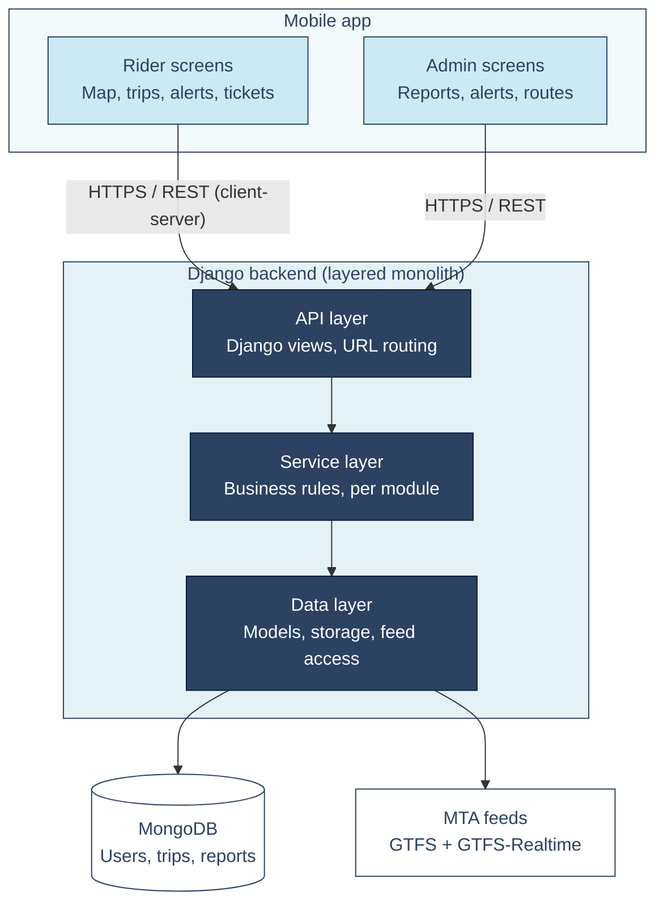

# SWE Capstone Project


**Team Members:** Caceres, Jainny; Mushorn, Zachary; Quigley, Paul; Samaniego, Jorge; Yalcinkaya, Kevin

**Kanban board:** [TransitHub NYC Project Board](PASTE_PROJECT_BOARD_URL)


## Proposal #1 - Work Order Ticketing System

**Description:** A web-based application which allows for the submission of tickets for work orders. The app would feature handling for user IDs, user roles/groups, ticket status tracking, display analytics, and ensuring the assignment of individual tickets to the appropriate users or groups. This project would require a frontend toolkit for the GUI alongside a database API such as Mongo for storage of relevant data.


## Proposal #2 - Self-Hosted Video Sharing App

**Description:** A web-based video sharing application which features comments on individual videos, ratings, content recommendations, multi-authored videos, and internal web traffic statistics. As an open-source application, the novelty of this app exists in its ability to be self-hosted and self-governed. We anticipate that we'll be using an open-source tool such as HandBrake to handle video encoding, an API to facilitate user authentication, an API for the frontend GUI, and Mongo for the necessary databases. 


## Proposal #3 - Public Transit App

**Description:** A mobile application that helps users search for public transportation and travel without any issues. This application would be perfect for daily public transportation commuters, student who commute, tourists and many more. Transportation can be very overwhelming due to many aspects when it comes to traveling. This app would help users find the best option for their trips with an interactive map route, real-time transit updates, a trip planner, nearby-stops in the area, and crowding information. For this project, frontend like React can possibly work and a database such as Mongo would be convenient. 


# Prototype

[TransitHub NYC Figma prototype](https://www.figma.com/proto/nCVNZNOuAAg0WNidMlfrSv/UI-Prototype-TransitHub-NY?node-id=3-217&p=f&t=NNRyeE9Sxl2l4PPX-1&scaling=min-zoom&content-scaling=fixed&page-id=0%3A1&starting-point-node-id=3%3A217)

## UX


## Context Diagram


TransitHub NYC treated as a single system, showing its external entities (riders, admins, MTA feeds, and a map provider) and the data exchanged with each. Dashed border = assumed service, not yet confirmed.

## Architecture



TransitHub NYC uses a client-server architecture. A mobile app, with screens for riders and for admins, sends requests over HTTPS and REST to a single Django backend. The backend is a monolith organized into three layers: an API layer that handles requests, a service layer that holds the business rules, and a data layer that reads and writes MongoDB and pulls routes, stops, and live alerts from the MTA's feeds.

## Test Plan

**test_users_cannot_see_each_others_trips** (integration test)

```python
def test_users_cannot_see_each_others_trips(self):
    self.signup()
    self.login("rider@example.com", NEW_USER["password"])
    self.assertEqual(self.client.get("/api/trips/").json(), [])
    self.assertGreater(self.db.trips.count_documents({}), 0)   # demo's trips do exist
```

- `self.signup()` creates a new rider with no trips.
- `self.login(...)` logs in as that rider.
- The first assert requests `/api/trips/` and checks that the list is empty.
- The second assert checks that other riders' trips exist in the database, so the empty list comes from privacy and not from missing data.

**test_trip_date_limits** (unit test)

```python
def test_trip_date_limits():
    assert q.validate_trip_date(q.now() + timedelta(days=31))
    assert q.validate_trip_date(q.now() - timedelta(days=1))
    assert q.validate_trip_date(q.now() + timedelta(days=3)) is None
```

- The first line passes a date 31 days ahead and expects an error message, because trips can only be planned up to 30 days ahead.
- The second line passes yesterday and expects an error message, because trips can't be planned in the past.
- The third line passes a date 3 days ahead and expects `None`, meaning the date is valid.

---

# Sprint 2

## Getting Started (new teammates start here)

**Requirements:** Git, Python 3.14, and access to the team's MongoDB Atlas cluster. Ask a teammate for the database password in a private message, never in the repo.

```bash
git clone https://github.com/Hexsl/SWE-Capstone-Project.git
cd SWE-Capstone-Project

# Create and activate a virtual environment
python -m venv .venv
.venv\Scripts\activate          # Windows
source .venv/bin/activate       # macOS / Linux

pip install -r requirements.txt
```

Copy `.env.example` to `.env` and fill in the values:

```bash
copy .env.example .env          # Windows
cp .env.example .env            # macOS / Linux
```

Generate your own Django secret key for `DJANGO_SECRET_KEY`:

```bash
python -c "from django.core.management.utils import get_random_secret_key; print(get_random_secret_key())"
```

Run the tests and the server:

```bash
python -m pytest
python manage.py runserver
```

The tests use `mongomock`, an in-memory fake MongoDB, so they run without an Atlas connection.

## CI/CD Pipeline

The pipeline lives in a single file, `.github/workflows/ci.yml`. It runs automatically on **every push and every pull request to `main`**.

| Stage | What it does |
|---|---|
| **Setup** | Checks out the code and installs Python 3.14 |
| **Dependencies** | Installs everything in `requirements.txt` (with pip caching) |
| **Test** | Runs the full pytest suite. A failing test fails the pipeline and blocks the merge. |
| **Deploy** | Runs **only after Test passes**, and only on pushes to `main` (after a PR is merged). Packages the backend and publishes it as a versioned GitHub Release (`build-<run number>`) under **Releases**. |

On pull requests, Deploy shows as **skipped**. This is intended: code is deployed only after it has been reviewed and merged.

Each stage is its own job, chained with `needs:`, so a failure in any stage stops everything after it.

## Branch Protection

`main` is protected by a repository ruleset named **Protect main**:

1. **Direct pushes to `main` are blocked.** All changes go through a pull request.
2. **Pull requests need at least one approval** from a teammate.
3. **The `Test` check must pass** before a pull request can be merged.

Force pushes and branch deletion are also blocked, and the bypass list is empty, so the rules apply to everyone, including admins.

**How we verified it:** a direct `git push` to `main` is rejected, and the Merge button stays disabled until there is an approval and a green Test check.

## Secrets Management

No API keys, tokens or passwords are stored in the code, the workflow file or the commit history.

| Variable | Where it lives | Used for |
|---|---|---|
| `MONGODB_URI` | Each developer's local `.env` | MongoDB Atlas connection |
| `MONGODB_DB` | Local `.env` | Database name |
| `DJANGO_SECRET_KEY` | Local `.env` | Django cryptographic signing |
| `WEATHER_API_KEY` | Local `.env`; GitHub Secrets if CI needs it | Weather API (planned feature) |
| `GITHUB_TOKEN` | Created automatically by GitHub for each run | Publishing releases in the Deploy stage |

- `.env` is listed in `.gitignore` and has never been committed.
- `.env.example` lists every required variable with blank or placeholder values.
- The Test stage uses `mongomock` and a dummy, non-secret Django key, so CI needs no real credentials.
- `backend/settings.py` reads `SECRET_KEY`, `DEBUG` and `ALLOWED_HOSTS` from environment variables.

**Sprint 2 secrets audit:**

- We searched the full commit history for connection strings and keys (`git log --all -G "mongodb"` and `git log --all -G "@cluster"`).
- A commit on `feature/lirr-map` had put a username and password into `.env.example`. We rewrote that commit so the credentials are no longer on any branch, and we rotated the Atlas password.
- The default Django `SECRET_KEY` was hard-coded in `settings.py`. We moved it to an environment variable and generated a new key, so the old one is no longer used anywhere.

**Adding a new secret:**

1. Add the variable name (no value) to `.env.example`.
2. Add the real value to your local `.env`.
3. If the pipeline needs it, add it under **Settings → Secrets and variables → Actions → New repository secret**, and reference it in `ci.yml` as `${{ secrets.NAME }}`.

## Contributing Workflow

Every user story follows the same path:

1. **Pick an issue** on the Kanban board and move it to *In Progress*.
2. **Create a feature branch** from an up-to-date `main`:
   ```bash
   git checkout main
   git pull
   git checkout -b feature/<issue-number>-short-name
   ```
3. **Write the code and at least one test** that checks the story's acceptance criteria. Put tests in `tests/`.
4. **Run the tests locally** with `python -m pytest`.
5. **Push and open a pull request** into `main`. In the description, write `Closes #<issue-number>` to link the issue.
6. **Request a teammate review.** The reviewer opens *Files changed → Review changes → Approve*.
7. **Wait for the green pipeline.** Setup, Dependencies and Test must pass.
8. **Merge.** The linked issue closes and moves to *Done*, and the Deploy stage publishes a new release.

## Epics & User Stories

### Epic 1: PASTE_EPIC_NAME

| Story | Issue | Pull Request | Acceptance Test |
|---|---|---|---|
| As a rider, I want to … | #__ | #__ | `tests/test_….py::test_…` |
| | | | |
| | | | |

### Epic 2: Rider Safety & Info ("More" section)

| Story | Issue | Pull Request | Acceptance Test |
|---|---|---|---|
| As a rider, I want emergency contact numbers in the More section so I can quickly reach police while traveling | #__ | #__ | `tests/test_….py::test_…` |
| As a developer, I want a weather API integration in place so weather can be shown in a future release | #__ | #__ | `tests/test_….py::test_…` |
| | | | |

## Features in Progress

### Emergency Contacts (More section)

The **More** section of the app lists contact numbers for the police agencies that cover our riders' area:

- **Emergency (any agency): 911**
- **MTA Police Department** (subways, LIRR and Metro-North)
- **NYPD** (New York City)
- **Nassau County Police Department**
- **Suffolk County Police Department**

Each agency's non-emergency number is shown with a tap-to-call link. These are public phone numbers, not secrets, so they are stored directly in the app. Numbers were verified against each agency's official website.

### Weather API (planned)

We are adding a weather API integration so the app can show current conditions and forecasts alongside trip information in a future release.

- The API key is read from the `WEATHER_API_KEY` environment variable and is never hard-coded.
- `WEATHER_API_KEY` is listed in `.env.example`.
- Tests mock the weather API's responses, so the pipeline needs neither the real key nor network access.

## AI-Use Statement

**Tools used:** Claude (Anthropic) and GitHub Copilot in VS Code.

**What we used them for:** drafting the GitHub Actions workflow, walking through the branch protection ruleset, auditing the Git history for leaked credentials, moving Django settings to environment variables, and drafting this README.

**What the AI got wrong, and how we found and fixed it:**

1. **Wrong tech stack.** The first workflow draft assumed a Node.js project (`npm ci`, `npm test`). Our backend is Django with pytest and mongomock. We caught this when our commit history showed a Django REST Framework API. We rewrote the workflow to use `actions/setup-python`, `pip install -r requirements.txt` and `python -m pytest`.
2. **Outdated action versions.** The workflow used `actions/checkout@v4` and `actions/setup-python@v5`. Every run then showed *"Node.js 20 is deprecated"* warnings in the run annotations. We updated to `actions/checkout@v5` and `actions/setup-python@v6`, and the warnings went away.
3. **Deploy assumed a host we didn't have.** The first Deploy stage called a `DEPLOY_HOOK_URL` secret for a hosting service we had never set up. The job failed with `curl: (3) URL rejected` because it was posting to an empty URL. We replaced it with a Deploy stage that publishes a GitHub Release using the built-in `GITHUB_TOKEN`.
4. **YAML indentation error.** While editing the AI-provided file, the `test:` job ended up indented by 3 spaces instead of 2. GitHub could no longer parse the workflow: runs failed instantly with no job output and showed the file path instead of the "CI/CD Pipeline" name. We compared the file against the run where all stages had passed, found the extra space, and fixed it.

**What we found that the AI's first pass missed:** two leftover template workflows (`django.yml` and `python-app.yml`) were running alongside ours. One started failing after we moved `SECRET_KEY` to an environment variable. We noticed runs with unfamiliar names ("Django CI") in the Actions tab and deleted both files, leaving `ci.yml` as the single pipeline.

# new
