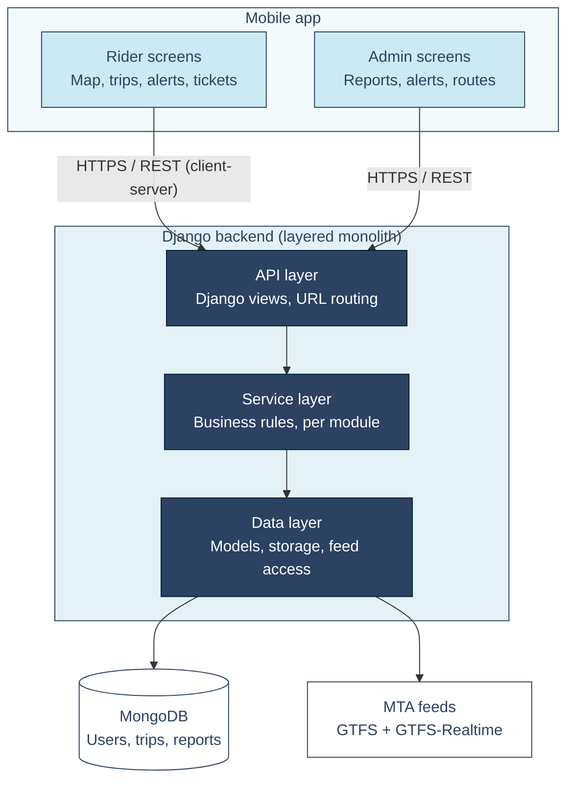

# SWE Capstone Project

**Team Members:** Caceres, Jainny; Mushorn, Zachary; Quigley, Paul; Samaniego, Jorge; Yalcinkaya, Kevin


## Proposal #1 - Work Order Ticketing System

**Description:** A web-based application which allows for the submission of tickets for work orders. The app would feature handling for user IDs, user roles/groups, ticket status tracking, display analytics, and ensuring the assignment of individual tickets to the appropriate users or groups. This project would require a frontend toolkit for the GUI alongside a database API such as Mongo for storage of relevant data.


## Proposal #2 - Self-Hosted Video Sharing App

**Description:** A web-based video sharing application which features comments on individual videos, ratings, content recommendations, multi-authored videos, and internal web traffic statistics. As an open-source application, the novelty of this app exists in its ability to be self-hosted and self-governed. We anticipate that we'll be using an open-source tool such as HandBrake to handle video encoding, an API to facilitate user authentication, an API for the frontend GUI, and Mongo for the necessary databases. 


## Proposal #3 - Public Transit App

**Description:** A mobile application that helps users search for public transportation and travel without any issues. This application would be perfect for daily public transportation commuters, student who commute, tourists and many more. Transportation can be very overwhelming due to many aspects when it comes to traveling. This app would help users find the best option for their trips with an interactive map route, real-time transit updates, a trip planner, nearby-stops in the area, and crowding information. For this project, frontend like React can possibly work and a database such as Mongo would be convenient. 


# Prototype

[TransitHub NYC Figma prototype](https://www.figma.com/proto/nCVNZNOuAAg0WNidMlfrSv/UI-Prototype-TransitHub-NY?node-id=3-217&p=f&t=NNRyeE9Sxl2l4PPX-1&scaling=min-zoom&content-scaling=fixed&page-id=0%3A1&starting-point-node-id=3%3A217)

## UX


## Context Diagram


TransitHub NYC treated as a single system, showing its external entities (riders, admins, MTA feeds, and a map provider) and the data exchanged with each. Dashed border = assumed service, not yet confirmed.

## Architecture



TransitHub NYC uses a client-server architecture. A mobile app, with screens for riders and for admins, sends requests over HTTPS and REST to a single Django backend. The backend is a monolith organized into three layers: an API layer that handles requests, a service layer that holds the business rules, and a data layer that reads and writes MongoDB and pulls routes, stops, and live alerts from the MTA's feeds.

## Test Plan

**test_users_cannot_see_each_others_trips** (integration test)

```python
def test_users_cannot_see_each_others_trips(self):
    self.signup()
    self.login("rider@example.com", NEW_USER["password"])
    self.assertEqual(self.client.get("/api/trips/").json(), [])
    self.assertGreater(self.db.trips.count_documents({}), 0)   # demo's trips do exist
```

- `self.signup()` creates a new rider with no trips.
- `self.login(...)` logs in as that rider.
- The first assert requests `/api/trips/` and checks that the list is empty.
- The second assert checks that other riders' trips exist in the database, so the empty list comes from privacy and not from missing data.

**test_trip_date_limits** (unit test)

```python
def test_trip_date_limits():
    assert q.validate_trip_date(q.now() + timedelta(days=31))
    assert q.validate_trip_date(q.now() - timedelta(days=1))
    assert q.validate_trip_date(q.now() + timedelta(days=3)) is None
```

- The first line passes a date 31 days ahead and expects an error message, because trips can only be planned up to 30 days ahead.
- The second line passes yesterday and expects an error message, because trips can't be planned in the past.
- The third line passes a date 3 days ahead and expects `None`, meaning the date is valid.
