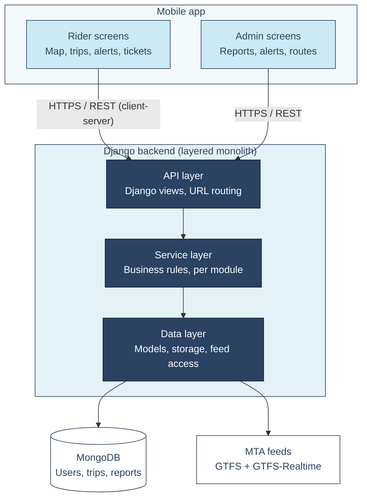

# SWE Capstone Project

**Team Members:** Caceres, Jainny; Mushorn, Zachary; Quigley, Paul; Samaniego, Jorge; Yalcinkaya, Kevin

## Proposal #1 - Work Order Ticketing System

**Description:** A web-based application which allows for the submission of tickets for work orders. The app would feature handling for user IDs, user roles/groups, ticket status tracking, display analytics, and ensuring the assignment of individual tickets to the appropriate users or groups. This project would require a frontend toolkit for the GUI alongside a database API such as Mongo for storage of relevant data.

## Proposal #2 - Self-Hosted Video Sharing App

**Description:** A web-based video sharing application which features comments on individual videos, ratings, content recommendations, multi-authored videos, and internal web traffic statistics. As an open-source application, the novelty of this app exists in its ability to be self-hosted and self-governed. We anticipate that we'll be using an open-source tool such as HandBrake to handle video encoding, an API to facilitate user authentication, an API for the frontend GUI, and Mongo for the necessary databases. 

## Proposal #3 - Public Transit App

**Description:** A mobile application that helps users search for public transportation and travel without any issues. This application would be perfect for daily public transportation commuters, student who commute, tourists and many more. Transportation can be very overwhelming due to many aspects when it comes to traveling. This app would help users find the best option for their trips with an interactive map route, real-time transit updates, a trip planner, nearby-stops in the area, and crowding information. For this project, frontend like React can possibly work and a database such as Mongo would be convenient. 

# Prototype

[TransitHub NYC Figma prototype](https://www.figma.com/proto/nCVNZNOuAAg0WNidMlfrSv/UI-Prototype-TransitHub-NY?node-id=3-217&p=f&t=NNRyeE9Sxl2l4PPX-1&scaling=min-zoom&content-scaling=fixed&page-id=0%3A1&starting-point-node-id=3%3A217)

## UX

## Context Diagram

TransitHub NYC treated as a single system, showing its external entities (riders, admins, MTA feeds, and a map provider) and the data exchanged with each. Dashed border = assumed service, not yet confirmed.

## Architecture

TransitHub NYC uses a client-server architecture. A mobile app, with screens for riders and for admins, sends requests over HTTPS and REST to a single Django backend. The backend is a monolith organized into three layers: an API layer that handles requests, a service layer that holds the business rules, and a data layer that reads and writes MongoDB and pulls routes, stops, and live alerts from the MTA's feeds.

## Test Plan

*Unit test: trip history filter check.* This test makes sure the Trip History screen shows the right trips when a rider taps a filter (All, Subway, Bus, or Rail), meaning a filter returns only trips of that transport type, newest first. We will make up four past trips for a fake rider: two subway trips, one bus trip, and one rail trip, each with a different date and time. We will then run the filtering function once with the Bus filter and check that exactly one trip comes back, the bus trip. We will also check that the All filter returns all four trips with the newest first, and that a filter with no matching trips returns an empty list instead of an error. The expected results come from the rule, not from whatever the code currently returns, so the test can catch a mistake such as a filter that lets subway trips through.

*Integration test: trip history privacy check.* This test makes sure the parts of the backend work together to keep each rider's trip history private. We will create two fake riders, Rider A with two trips and Rider B with one, and save them in a test database. We will then log in as Rider A, request the trip history through the real API, and check that exactly Rider A's two trips come back and none of Rider B's. We will also send the same request without logging in and check that it is rejected. This runs the API layer, service layer, and data layer together against a test database, so it can catch problems that only show up when the pieces are connected, such as a query that forgets to filter by rider.
